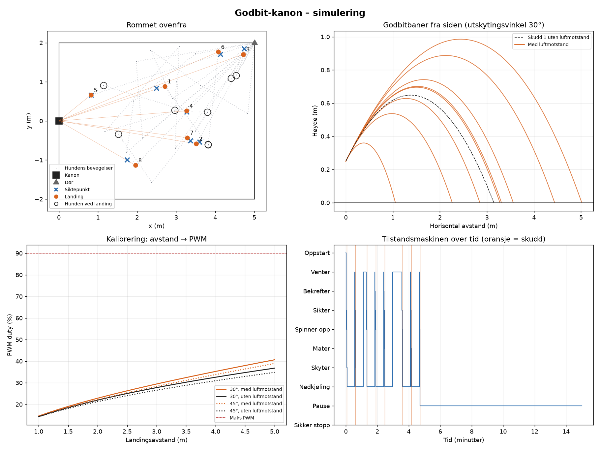

# Godbit-kanon

A Raspberry Pi 5 treat cannon for dogs. A camera spots the dog with YOLO, a pan/tilt mount aims at the floor just in front of it, and two flywheels launch a single piece of kibble with a speed that matches the distance.

This repository currently holds the **simulator**: the full control logic running against a virtual dog, camera, servos and flywheels, so the system can be developed and tuned before any hardware is wired up.



> Code, comments and command-line output are in Norwegian. The class and option names are explained below.

## What it simulates

| Part | Model |
|---|---|
| Dog | Rests, wanders, leaves the room through a door, runs to treats that land |
| Camera + YOLO | Camera Module 3 Wide (102° FOV), 10 fps, 8 % missed detections, pixel noise, distance from bounding box (±10 %) or VL53L1X ToF (±2 %) |
| Servos | MG996R pan/tilt and SG90 feeder with limited speed (300 °/s) |
| Flywheels | Two 385 motors on a DRV8871, linear PWM → exit speed model |
| Treat flight | 2D trajectory with quadratic air drag |
| Controller | The state machine from the design: *Oppstart → Venter → Bekrefter → Sikter → Spinner opp → Mater → Skyter → Nedkjøling*, plus *Pause* and *Sikker stopp* |

## Setup

Requires Python 3.9 or newer.

**Windows (PowerShell)**

```powershell
py -m venv .venv
.\.venv\Scripts\Activate.ps1
pip install numpy matplotlib
```

**Linux / WSL / macOS**

```bash
python3 -m venv .venv
source .venv/bin/activate
pip install numpy matplotlib
```

On Ubuntu, also run `sudo apt install python3-venv python3-tk` first. `python3-tk` is needed for `--vis` to open a window.

## Usage

```bash
python kanon_sim.py                  # 15 simulated minutes, saves kanon_sim.png
python kanon_sim.py --vis            # also show the plot in a window
python kanon_sim.py --tof            # use the VL53L1X distance sensor
python kanon_sim.py --feil 200       # inject an I²C fault after 200 s
python kanon_sim.py --elev 40 --seed 7
```

| Option | Default | Meaning |
|---|---|---|
| `--minutter` | `15` | Simulated time in minutes |
| `--seed` | `1` | Random seed. The same seed gives the same run |
| `--tof` | off | Measure distance with the VL53L1X instead of the bounding box |
| `--elev` | `30` | Launch angle in degrees |
| `--kvote` | `8` | Maximum shots per day |
| `--cooldown` | `30` | Seconds between shots |
| `--feil SEK` | none | Make the PCA9685 stop responding after `SEK` seconds |
| `--stille` | off | Print only the summary, not every state change |
| `--ut` | `kanon_sim.png` | Output file for the plot |
| `--vis` | off | Show the plot in a window |

### Output

The console prints every state change and a summary per shot:

```
[04:40.7]    Bekrefter → Sikter       sett i 5 bilder på rad
[04:42.0]       Sikter → Spinner opp  d≈2.42 m, sikter på 2.02 m, v=4.51 m/s, PWM 23 %
...
Snitt avvik fra siktepunkt: 0.12 m
Snitt avstand fra hunden ved landing: 0.60 m (ønsket ≈ 0.4 m)
Landet innen 0,75 m fra hunden: 6 av 8
```

The plot has four panels: the room seen from above with aim points, landings and the dog's position, the trajectories from the side, the distance → PWM calibration curve, and the state machine over time.

## How it works

### Physics

The treat is treated as a sphere with quadratic drag:

$$
m\,\frac{d\vec v}{dt} = m\vec g - \tfrac12\,\rho\,C_d\,A\,|\vec v|\,\vec v
$$

The required exit speed for a target distance $d$ is found by bisection, then converted to PWM duty with

$$
v = \eta\,\pi D\,\frac{n_{\max}}{60}\cdot \text{duty}
$$

where $D$ is the flywheel diameter, $n_{\max}$ the motor's no-load rpm and $\eta$ the ratio between treat speed and wheel surface speed.

### Structure

| Class | Role |
|---|---|
| `Config` | Every tunable number in one place |
| `Ballistikk` | Trajectory integration and speed solver |
| `MotorModell` | PWM duty ↔ exit speed |
| `Hund`, `Verden` | The simulated dog and room |
| `SimMaskinvare` | Simulated hardware: camera, servos, motors, I²C faults |
| `Kontroller` | The state machine. Hardware-independent |

### Moving to real hardware

`Kontroller` only talks to the hardware through these methods:

| Method | Real hardware |
|---|---|
| `selvtest()` | Check that the PCA9685 answers at I²C address `0x40` |
| `set_pan(deg)`, `set_tilt(deg)` | PCA9685 channels 0 and 1 |
| `mat(sikte)` | PCA9685 channel 2 (SG90 feeder) |
| `set_motor(duty)` | Hardware PWM on GPIO18 → DRV8871 |
| `detect()` | Picamera2 + YOLO, returns `(pixel_x, distance_m)` or `None` |
| `nodstopp()` | Motors off |

Writing a `PiMaskinvare` class with the same methods lets `Kontroller` run unchanged on the Pi. On Raspberry Pi OS, create the environment with `python3 -m venv --system-site-packages .venv` so it can see Picamera2, which is installed through `apt`.

### Tuning

Values to measure and update in `Config` once parts arrive:

- `eff`: treat exit speed divided by wheel surface speed
- `bit_m`, `bit_d`: mass and diameter of the treats you actually use
- `mount_h`: height of the flywheels above the floor
- `servo_speed_dps`, `pan_sigma_deg`: real servo speed and play

## Hardware

| Part | Choice |
|---|---|
| Computer | Raspberry Pi 5, own 27 W USB-C supply |
| Camera | Camera Module 3 Wide |
| Servo driver | PCA9685, 16 channels |
| Aim | 2 × MG996R in an aluminium pan/tilt bracket |
| Feeder | SG90 |
| Flywheels | 2 × 385 DC motor, 12 V, 2.3 mm shaft, ~50 mm wheels |
| Motor driver | DRV8871 |
| Power | Mean Well LRS-75-12 (12 V, 6 A) + buck regulator 12 → 6 V, at least 5 A |
| Distance (optional) | VL53L1X |

## Safety

The cannon aims at the floor about 0.4 m in front of the dog, never at the dog itself, and refuses to shoot when the dog is closer than 1 m. Keep the flywheel speed low, and keep the 230 V side of the power supply fully enclosed.
